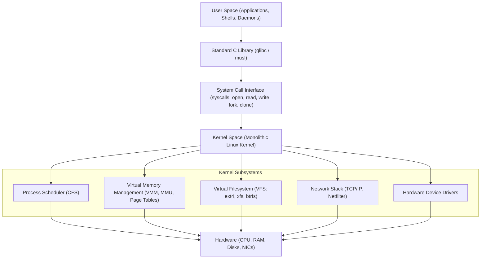

# 🐧 Linux Systems Engineering & Administration Masterclass

[](https://kernel.org)
[](https://ubuntu.com)
[](https://redhat.com)
[](LICENSE)

> Complete zero-to-hero curriculum in Linux systems engineering, operating system architecture, process observability, permissions, systemd service orchestration, industrial networking, and automated shell scripting.

---

## 📑 Curriculum & Architecture Roadmap

```
Level 0: OS Architecture & FHS ──► Level 1: Terminal, Streams & Pipes ──► Level 2: Permissions & Sudoers
                                                                                    │
Level 5: Industrial Networking  ◄── Level 4: systemd & Automation    ◄── Level 3: Processes & Signals
```

| Level | Topic | Description | Link |
|---|---|---|---|
| **Level 0** | **OS Foundations & Filesystem** | Kernel vs User space, Boot sequence (BIOS/UEFI -> GRUB -> systemd), FHS (`/etc`, `/proc`, `/sys`) | [`LEVEL_0_OS_FOUNDATIONS_AND_INSTALLATION.md`](docs/LEVEL_0_OS_FOUNDATIONS_AND_INSTALLATION.md) |
| **Level 1** | **Terminal, Streams & Pipes** | stdin/stdout/stderr, I/O redirection (`2>&1`), `grep`, `awk`, `sed`, `find`, `xargs` | [`LEVEL_1_TERMINAL_FOUNDATIONS.md`](docs/LEVEL_1_TERMINAL_FOUNDATIONS.md) |
| **Level 2** | **Permissions & Security** | Octal & symbolic chmod, chown, umask, SUID/SGID/Sticky bits, `/etc/sudoers` | [`LEVEL_2_PERMISSIONS_AND_SECURITY.md`](docs/LEVEL_2_PERMISSIONS_AND_SECURITY.md) |
| **Level 3** | **Processes & Observability** | Lifecycle, signals (SIGTERM 15, SIGKILL 9, SIGHUP 1), `ps`, `top`, `htop`, `/proc`, OOM killer | [`LEVEL_3_PROCESSES_AND_OBSERVABILITY.md`](docs/LEVEL_3_PROCESSES_AND_OBSERVABILITY.md) |
| **Level 4** | **systemd & Automation** | Custom `.service` units, `systemctl`, `journalctl`, systemd timers vs crontab | [`LEVEL_4_SYSTEMD_AND_AUTOMATION.md`](docs/LEVEL_4_SYSTEMD_AND_AUTOMATION.md) |
| **Level 5** | **Networking & Storage** | `ip`, `ss`, `curl`, `ufw`/`iptables`, SSH key hardening, `rsync`, LVM volumes | [`LEVEL_5_NETWORKING_AND_SECURITY.md`](docs/LEVEL_5_NETWORKING_AND_SECURITY.md) |
| **Reference** | **Command Glossary** | Complete DevOps commands cheatsheet with practical real-world flags | [`COMMAND_GLOSSARY_CHEATSHEET.md`](docs/COMMAND_GLOSSARY_CHEATSHEET.md) |
| **Runbook** | **Incident Response** | SOPs for High CPU, OOM kills, Disk full, and Network connection drops | [`INCIDENT_RESPONSE_RUNBOOK.md`](docs/INCIDENT_RESPONSE_RUNBOOK.md) |
| **Exam** | **Masterclass Examination** | 24 Multiple-choice questions with deep technical rationale | [`QUIZ.md`](QUIZ.md) |

---

## 🏛️ Linux Architecture Overview

The Linux operating system operates on a dual-mode protection ring architecture:



---

## 🗂️ Linux Filesystem Hierarchy Standard (FHS)

| Directory | Purpose & Industrial Best Practices |
|---|---|
| `/bin`, `/usr/bin` | Essential executable user binaries (`ls`, `cat`, `bash`, `python3`). |
| `/sbin`, `/usr/sbin` | Essential system administration binaries requiring root privileges (`iptables`, `fdisk`, `reboot`). |
| `/etc` | Host-specific static system configurations (`/etc/fstab`, `/etc/passwd`, `/etc/nginx/`, `/etc/sudoers`). |
| `/var` | Variable dynamic files, spoolers, and logs (`/var/log`, `/var/mail`, `/var/lib/docker`). |
| `/proc` | Pseudo-filesystem representing kernel internal state and running process memory map (`/proc/cpuinfo`, `/proc/[pid]/`). |
| `/sys` | Sysfs virtual filesystem exposing kernel devices, buses, drivers, and power parameters. |
| `/dev` | Device files representing physical hardware (`/dev/sda`, `/dev/null`, `/dev/urandom`, `/dev/zero`). |
| `/opt` | Add-on application software packages installed from third-party vendors. |
| `/tmp` | Temporary volatile storage emptied at system boot or via `systemd-tmpfiles`. |

---

## 🛠️ Production Automation Scripts Included

This repository provides full, tested, production-grade automation scripts in the [`scripts/`](scripts/) folder:

1. **[`01_system_health_check.sh`](scripts/01_system_health_check.sh)**: Audits CPU load average, memory usage percentage, disk space thresholds (>80% trigger), top CPU processes, and listening network ports.
2. **[`02_automated_backup.sh`](scripts/02_automated_backup.sh)**: Automated directory backup with tar, gzip, MD5 checksum validation, and 7-day retention cleanup.
3. **[`03_user_provisioning.sh`](scripts/03_user_provisioning.sh)**: Automates user creation, shell assignments, passwordless sudoer rules, and SSH public key installation.
4. **[`04_log_analyzer.sh`](scripts/04_log_analyzer.sh)**: High-performance access log parser utilizing `awk` and `grep` to extract top client IPs, status code frequency, and 4xx/5xx error anomalies.
5. **[`05_firewall_hardening.sh`](scripts/05_firewall_hardening.sh)**: Configures UFW/iptables with default DROP policies, SSH rate limiting, and web ports.
6. **[`06_service_watchdog.sh`](scripts/06_service_watchdog.sh)**: Health monitor daemon that automatically restarts hung systemd units and alerts on failure.

---

## 🚀 systemd Service Unit Blueprint

Located in [`systemd/teachcloud-backend.service`](systemd/teachcloud-backend.service):

```ini
[Unit]
Description=TeachCloud Production Backend Application Service
After=network.target remote-fs.target
Wants=network-online.target

[Service]
Type=simple
User=www-data
Group=www-data
WorkingDirectory=/var/www/teachcloud
ExecStart=/usr/local/bin/gunicorn --workers 4 --bind 127.0.0.1:8000 wsgi:app
ExecReload=/bin/kill -s HUP $MAINPID
Restart=always
RestartSec=5s

# Security Sandboxing
ProtectSystem=strict
ProtectHome=true
NoNewPrivileges=true
PrivateTmp=true

# Resource Limits
LimitNOFILE=65535
MemoryMax=1G
CPUQuota=200%

[Install]
WantedBy=multi-user.target
```

---

## 🧪 Testing Your Knowledge

Take the complete 24-question multiple-choice exam in [`QUIZ.md`](QUIZ.md). It features rigorous questions on permissions calculation, signal handling, process lifecycle, virtual memory, systemd directives, and TCP socket states.
