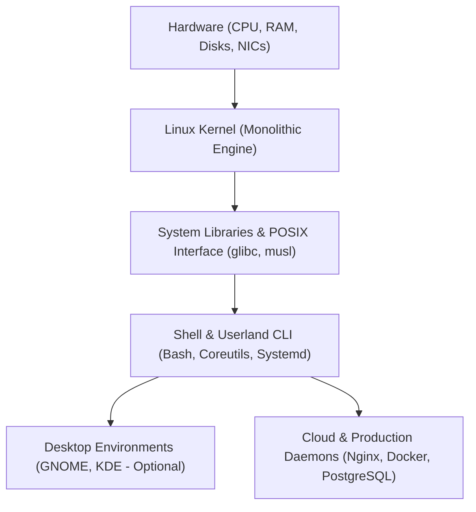

# 🐧 Level 0: Linux Operating System Foundations & Cross-Platform Architecture

Welcome to the foundational entry point of the **Linux Zero-to-Hero Masterclass**. Before executing terminal commands, software engineers and DevOps architects must understand what an operating system kernel is, how Linux fundamentally differs from Microsoft Windows and Apple macOS, and how to properly provision a Linux environment across any hardware.



---

## 🏛️ 1. What is Linux? (Kernel vs. Distribution)

A frequent misconception among newcomers is referring to "Linux" as a monolithic operating system like Windows 11 or macOS Sequoia. Strictly speaking:

1. **The Linux Kernel**: Created by Linus Torvalds in 1991, the kernel is the core program that controls the computer hardware: scheduling CPU processes, managing memory pages, controlling disk blocks, and processing network socket interrupts.
2. **GNU Userland**: The standard utilities, compiler toolchains, and shell environments (`bash`, `coreutils`, `tar`, `grep`, `gcc`) that allow humans and scripts to interact with the kernel.
3. **Linux Distribution (Distro)**: A complete, packaged operating system bundling the Linux kernel, GNU utilities, a package manager, system services, and optional desktop environments:
   * **Debian / Ubuntu Family**: High stability, standard for cloud servers and container base images. Package manager: `apt` (`.deb`).
   * **Red Hat / Fedora / Rocky Linux Family**: Enterprise corporate standard with strict SELinux mandatory access controls. Package manager: `dnf` / `rpm`.
   * **Arch / Alpine Linux Family**: Bleeding-edge rolling releases (Arch) or hyper-minimal security-focused 5MB images (Alpine) built on `musl` libc for Docker microservices.

---

## ⚖️ 2. Comprehensive OS Comparison: Linux vs. macOS vs. Windows

Understanding the fundamental architectural trade-offs between the three major operating systems is critical for software engineering and systems administration. Here is the in-depth vertical breakdown ordered by relevance to server and systems engineering:

### 1. 🐧 Linux (First: Cloud, Servers, AI & Containers Standard)
* **Kernel Architecture**: **Monolithic Kernel** (`vmlinuz`). All operating system services (process scheduler, virtual memory manager, network stack, filesystem drivers) run in unified kernel space. Device drivers run dynamically as loadable kernel modules (`.ko`). This design eliminates IPC context-switching overhead, delivering raw performance.
* **Filesystem Hierarchy**: **Single Unified Root (`/`)**. An inverted tree hierarchy without drive letters. All physical storage drives, network NFS shares, and virtual filesystems attach to mountpoints under root (e.g. `/etc`, `/var`, `/home`, `/mnt`). Paths use forward slashes (`/`) and are strictly case-sensitive (`Server.conf` ≠ `server.conf`).
* **Process & Device Philosophy**: **"Everything is a File"**. Hardware block storage (`/dev/sda`), system telemetry (`/proc/meminfo`), process descriptors (`/proc/<pid>/`), kernel tunables (`/sys`), named pipes, and network sockets are standard file descriptors. You can inspect and debug the host using standard Unix streaming utilities (`cat`, `grep`, `dd`, `awk`).
* **Headless Capability**: **100% Headless Native**. Production Linux instances run with zero graphical overhead (no X11 or Wayland display server needed). Base idle memory footprint is remarkably small: ~150MB to 500MB RAM, allowing thousands of containers or tiny microservices to run per host.
* **Security & Permissions**: **POSIX DAC & Mandatory Access Controls (MAC)**. Granular User / Group / Other bitwise permissions (`rwxr-xr-x`, octal `600`, `755`), superuser isolation (`root` / `sudo`), and enterprise-grade mandatory controls via AppArmor (Ubuntu/Debian) or SELinux (RHEL/CentOS).
* **Software & Package Management**: **Cryptographic Centralized Repositories**. Tools like `apt`, `dnf`, `pacman`, and `apk` pull signed binaries from trusted mirrors. A single command updates the entire operating system, kernel, libraries, and applications atomically.
* **Industry Dominance**: Powers 96%+ of the world's top 1M cloud servers, 100% of the world's top 500 supercomputers, the entire container orchestration ecosystem (Docker & Kubernetes), Android mobile devices, and high-performance AI training clusters.

---

### 2. 🍎 Apple macOS (Next: Unix Darwin / Workstation Standard)
* **Kernel Architecture**: **Hybrid XNU Kernel** (Darwin). Synthesizes the Carnegie Mellon Mach 3.0 microkernel (IPC, scheduling, virtual memory) with the FreeBSD 5 POSIX userland and networking stack, topped with the Apple I/O Kit for C++ object-oriented driver management.
* **Filesystem Hierarchy**: **Unified Root with Apple Directory Conventions**. Rooted at `/`, but organized around macOS frameworks: `/Applications`, `/Library`, `/System`, `/Users`, and external volumes at `/Volumes/`. Modern Macs use APFS (Apple File System), which is formatted as case-preserving but case-insensitive by default.
* **Process & Device Philosophy**: **Hybrid BSD File Descriptors & Apple Frameworks**. Provides POSIX compliant APIs and BSD sockets beneath high-level Objective-C and Swift frameworks (Cocoa, Metal, CoreFoundation). Hardware interaction requires signed DriverKit extensions.
* **Headless Capability**: **Consumer Desktop Tied**. macOS cannot be legally run on commodity cloud hardware (Apple licensing restricts execution to genuine Apple Mac hardware). It always runs the WindowServer and Aqua graphical compositor, consuming 3GB to 6GB RAM at idle.
* **Security & Permissions**: **POSIX Permissions + Sandboxing & SIP**. Traditional Unix permissions layered under System Integrity Protection (SIP — rootless security locking down `/System`), Gatekeeper (cryptographic developer signing and notarization), and TCC (Transparency, Consent, and Control prompting for disk, microphone, and camera access).
* **Software & Package Management**: **Hybrid App Store, DMG Drag-and-Drop & Community CLI**. Software is distributed via the Mac App Store, `.dmg` / `.pkg` installer bundles, or the de-facto developer community package manager Homebrew (`brew install`). macOS lacks a built-in official terminal package manager.
* **Industry Dominance**: The premier developer laptop workstation for software engineers due to its Unix foundation, zsh terminal, and energy-efficient Apple Silicon (M-series) architecture. Mandatory toolchain host for building native iOS, iPadOS, and macOS apps.

---

### 3. 🪟 Microsoft Windows (At the End: Enterprise Workstations & Gaming Standard)
* **Kernel Architecture**: **Hybrid NT Microkernel** (`ntoskrnl.exe`). Features an Executive subsystem (Object Manager, Security Reference Monitor, Process Manager) and a Hardware Abstraction Layer (HAL). Separates user-mode driver frameworks (UMDF) from kernel-mode drivers (KMDF).
* **Filesystem Hierarchy**: **Drive Letters (`C:\`, `D:\`) & Backslashes (`\`)**. Independent storage drives are partitioned as distinct drive letters. System components reside in `C:\Windows\System32`, user profiles in `C:\Users\<Username>`. The underlying NTFS filesystem is case-preserving but case-insensitive by default.
* **Process & Device Philosophy**: **Win32 APIs & Centralized Binary Registry**. Instead of "everything is a file", hardware devices, installed application keys, file associations, and kernel parameters are stored in hierarchical binary databases called the Registry (`HKLM`, `HKCU`). Programs interact primarily through Win32, COM, and .NET APIs.
* **Headless Capability**: **GUI-Tied by Design**. Although Windows Server provides "Server Core" for text-only operations, standard client editions (Windows 10/11) mandate the Desktop Window Manager (DWM) and Windows Explorer shell, resulting in a baseline idle consumption of 3GB to 4.5GB RAM.
* **Security & Permissions**: **Access Control Lists (ACLs) & SIDs**. Security Identifiers (SIDs) tied to Discretionary Access Control Lists (DACLs) and System ACLs (SACLs). Administrative privilege escalation occurs via User Account Control (UAC) interactive popups. Highly integrated with corporate Active Directory / Entra ID Kerberos domain authentication.
* **Software & Package Management**: **Decentralized Installers & Modern Package Managers**. Historically managed via standalone `.exe` and `.msi` wizard setups. Modern Windows incorporates the Windows Package Manager (`winget`), Chocolatey, and the Microsoft Store.
* **Industry Dominance**: Dominates enterprise corporate office workstations, Active Directory enterprise networks, internal enterprise desktop applications, and consumer PC gaming (DirectX). For DevOps, Windows bridges to Linux via WSL 2 (Windows Subsystem for Linux).

---

## 🛠️ 3. Linux Installation & Environment Setup Guide

You can run Linux in several ways depending on your current operating system and hardware setup. Choose the method that best matches your workflow.

### Option A: Windows Subsystem for Linux (WSL 2) — *Recommended for Windows Users*
WSL 2 runs a real, lightweight Linux kernel inside a hyper-optimized virtualized utility container directly inside Windows 10/11 with zero performance lag and native access to Windows files.

1. Open **PowerShell** as Administrator:
   ```powershell
   wsl --install -d Ubuntu-24.04
   ```
2. Restart your computer if prompted.
3. Upon reboot, an Ubuntu terminal window will launch. Enter your desired Linux **username** and **password**.
4. Verify your kernel and distribution:
   ```bash
   uname -a
   cat /etc/os-release
   ```
5. Access your Windows files inside Linux at `/mnt/c/`.

---

### Option B: macOS Linux Environments — *Recommended for Mac Users*
macOS is POSIX-compliant Unix, but its userland is BSD-based, not GNU/Linux. To practice pure Linux system administration on Apple Silicon (M1/M2/M3/M4) or Intel Macs:

1. **OrbStack (Fastest & Lightest)**:
   * Install via Homebrew: `brew install orbstack`
   * Launch a high-performance native Ubuntu machine in 2 seconds via the UI or CLI:
     ```bash
     orb create ubuntu:24.04 dev-linux
     orb -m dev-linux
     ```
2. **Canonical Multipass (Official Ubuntu VM Engine)**:
   ```bash
   brew install multipass
   multipass launch --name teachcloud-box 24.04
   multipass shell teachcloud-box
   ```

---

### Option C: Hypervisor Virtual Machine (VirtualBox / VMware)
If you want a dedicated sandbox with an isolated virtual disk and optional graphical desktop:

1. Download [Oracle VirtualBox](https://www.virtualbox.org/) or VMware Workstation Player.
2. Download the official **Ubuntu Server 24.04 LTS ISO** (or Ubuntu Desktop) from [ubuntu.com](https://ubuntu.com/download/server).
3. Create a New Virtual Machine:
   * **RAM**: 2048 MB minimum (4096 MB recommended).
   * **CPUs**: 2 vCPUs.
   * **Disk**: 25 GB dynamically allocated virtual hard disk (VDI/VMDK).
4. Attach the ISO to the virtual optical drive and power on the VM.
5. Follow the interactive installer: select language, configure network (DHCP), allocate full disk with LVM, create your admin user, and enable **OpenSSH Server**.

---

### Option D: Bare-Metal Dual Boot (Direct Hardware Installation)
For maximum native performance on physical hardware (laptops or custom desktops):

1. **Create Bootable USB Media**:
   * Download the Ubuntu ISO.
   * Flash the ISO to a USB flash drive (8GB+) using [Rufus](https://rufus.ie/) (Windows) or [BalenaEtcher](https://etcher.balena.io/) (Mac/Linux).
2. **Prepare Disk Partition**:
   * In Windows Disk Management (`diskmgmt.msc`), shrink an existing drive to create at least 40GB–100GB of "Unallocated Space".
3. **Boot into BIOS / UEFI**:
   * Restart computer and tap `F12`, `F2`, or `Del`.
   * Disable `Fast Boot` and configure Boot Order to boot from the USB drive.
4. **Partition Layout**:
   * In the Ubuntu installer, choose **"Install alongside Windows Boot Manager"** (or choose "Something Else" for manual partitions: `/boot/efi` 512MB, `swap` 8GB, `/` root partition remaining ext4).
5. Complete installation and reboot into GRUB bootloader to choose between Linux and Windows.

---

### Option E: Production Cloud VPS (AWS / DigitalOcean / Hetzner)
The industry standard for deploying real-world production servers:

1. Create a cloud instance (AWS EC2 `t3.micro` or DigitalOcean `s-1vcpu-1gb`) with **Ubuntu 24.04 LTS**.
2. Select your SSH Public Key for cryptographic authentication.
3. Connect from your local terminal:
   ```bash
   ssh -i ~/.ssh/id_ed25519 ubuntu@<PUBLIC_SERVER_IP>
   ```

---

## 🚀 4. Immediate Post-Installation Checklist

Once logged into your newly provisioned Linux terminal, execute these essential maintenance commands:

```bash
# 1. Refresh cryptographic package index and upgrade existing packages
sudo apt update && sudo apt upgrade -y

# 2. Install essential diagnostic and development utilities
sudo apt install -y curl wget git vim htop ufw net-tools

# 3. Verify user identity, host environment and timezone
whoami
hostnamectl
timedatectl set-timezone UTC

# 4. Check available storage and memory
df -h
free -h
```

Now that your Linux environment is active and its architectural foundations are understood, proceed to [`docs/Linux/LEVEL_1_TERMINAL_FOUNDATIONS.md`](LEVEL_1_TERMINAL_FOUNDATIONS.md) to master shell navigation and file pipelines!
