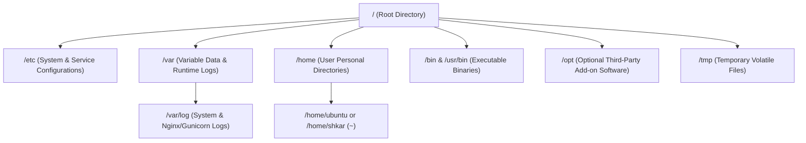
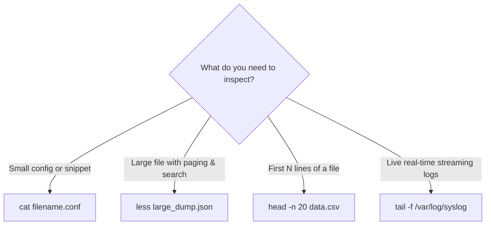
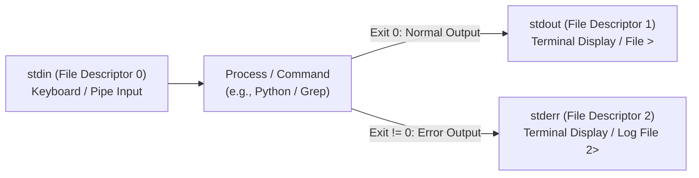

# 🐧 Level 1: Terminal Foundations & Shell Mastery (Beginner)

Welcome to **Level 1** of the TeachCloud Linux Masterclass. This guide eliminates terminal fear by turning the Linux command-line interface (CLI) into an intuitive, transparent environment for software engineers and DevOps practitioners.

---

## 🗺️ Master Curriculum Overview

| Module | Core Concepts | Essential Commands & Tokens | Production DevOps Relevance |
| :--- | :--- | :--- | :--- |
| **Lesson 1.1** | The Linux File Tree Architecture | `/`, `/etc`, `/var/log`, `/home`, `/bin`, `/opt`, `/tmp`, `~`, `.`, `..` | Navigating server configurations, container mounts, and log stores. |
| **Lesson 1.2** | Core Navigation & File Manipulation | `pwd`, `ls -la`, `cd`, `mkdir -p`, `cp -r`, `mv`, `rm -rf`, `touch` | Directory scaffolding, code deployment, and safe artifact cleanup. |
| **Lesson 1.3** | Reading & Searching File Contents | `cat`, `less`, `head -n 20`, `tail -f`, `find`, `grep -rn` | Production log analysis, finding source files, and live troubleshooting. |
| **Lesson 1.4** | I/O Streams, Redirection & Pipes | `stdin (0)`, `stdout (1)`, `stderr (2)`, `>`, `>>`, `2>&1`, `/dev/null`, `\|` | Automated scripts, cron job output suppression, and telemetry pipelines. |

---

## 📁 Lesson 1.1 — The Linux File Tree Architecture

Unlike Windows, which assigns letters to separate storage drives (`C:\`, `D:\`), Linux presents a single unified hierarchical tree starting at the root directory: `/`.



### Essential Root Subdirectories Every Engineer Must Know:
1. **`/` (Root)**: The foundation of the entire filesystem. Every disk, partition, and external volume mounts beneath `/`.
2. **`/etc` (Editable Text Configuration)**: Contains static configuration files for the operating system and installed services (e.g., `/etc/nginx/nginx.conf`, `/etc/hosts`, `/etc/environment`).
3. **`/var/log` (Variable Logs)**: Stores runtime logs generated by the OS, systemd daemons, web servers, and databases (e.g., `/var/log/syslog`, `/var/log/nginx/access.log`).
4. **`/home` (User Home Directories)**: User-specific data and configuration files. For user `shkar`, home is `/home/shkar`. The tilde character `~` is shorthand for your current home folder.
5. **`/bin` & `/usr/bin` (User Binaries)**: Houses standard command executables (`python3`, `bash`, `ls`, `curl`, `git`).
6. **`/opt` (Optional Software)**: Dedicated directory for third-party commercial applications and standalone software suites (e.g., `/opt/google`, `/opt/datadog`).
7. **`/tmp` (Temporary Storage)**: Scratch space accessible to all users. Modern Linux systems mount this in RAM (`tmpfs`), and its contents are automatically wiped on reboot or by periodic systemd cleanup.

### Relative vs. Absolute Paths
* **Absolute Path**: Begins with a leading slash `/` and specifies the complete path from root:
  ```bash
  cat /var/log/nginx/access.log
  cd /home/shkar/PyCharmProject/Dev/cloud_flask
  ```
* **Relative Path**: Specifies a path relative to the **Current Working Directory** without a leading `/`:
  * `.` refers to the **current directory**.
  * `..` refers to the **parent directory** (one level up).
  * `~` expands to the logged-in user's home directory (`$HOME`).
  ```bash
  cd ../nginx/             # Move to parent, then into nginx/
  python3 ./app.py         # Execute app.py in current directory
  cd ~/projects            # Move to /home/<user>/projects
  ```

---

## 🧭 Lesson 1.2 — Core Navigation & File Manipulation

The command shell is where production servers are managed. These eight commands form the foundation of day-to-day operations:

### 1. `pwd` (Print Working Directory)
Displays the full absolute path of where you currently stand:
```bash
pwd
# Output: /home/shkar/PyCharmProject/Dev/cloud_flask
```

### 2. `ls -la` (List Directory Contents with Metadata)
* `-l`: Long listing format (permissions, owner, group, byte size, modification timestamp).
* `-a`: Shows hidden files (files beginning with `.`, such as `.env`, `.gitignore`).
```bash
ls -la
# Output format:
# drwxr-xr-x 14 shkar shkar 4096 Oct 19 19:20 .
# -rw-r--r--  1 shkar shkar  445 Sep 13 17:22 .env
# -rw-r--r--  1 shkar shkar 2048 Oct 19 18:00 app.py
```

### 3. `cd` (Change Directory)
```bash
cd /var/log        # Navigate via absolute path
cd ..              # Jump up one level
cd -               # Jump back to previous directory (toggle)
cd ~               # Jump to home directory
```

### 4. `mkdir -p` (Make Directory with Parent Hierarchy)
The `-p` (parents) flag creates all missing intermediate directories without failing:
```bash
mkdir -p /opt/teachcloud/deployments/releases/v1.0.0
```

### 5. `cp -r` (Copy Files and Recursive Directories)
* Copy a single file: `cp config.json config.json.bak`
* Copy an entire folder recursively: `cp -r templates/ templates_backup/`

### 6. `mv` (Move or Rename Files)
Unlike graphical file managers, moving and renaming in Linux are the identical atomic operation:
```bash
mv app.py server.py               # Rename in same directory
mv server.py cloud_app/           # Move to subdirectory
```

### 7. `rm -rf` (Remove Files and Directories Safely)
* `-r`: Recursive (deletes directory tree).
* `-f`: Force (suppresses confirmation prompts for read-only files).
> [!CAUTION]
> **Production Danger**: Running `rm -rf /` or `rm -rf $DIR/` when `$DIR` is empty wipes the entire system. Always verify the path with `ls` or `pwd` before issuing `rm -rf`.

### 8. `touch` (Create Empty File or Update Timestamps)
Creates a new 0-byte file if it does not exist, or touches the file's modification timestamp:
```bash
touch /tmp/deploy.lock
```

---

## 🔍 Lesson 1.3 — Reading & Searching File Contents

DevOps engineers spend more time reading logs and configs than editing them. Choosing the right inspection tool is critical for system stability.



### 1. `cat` (Concatenate and Print)
Dumps the entire file to terminal standard output.
> [!WARNING]
> Never run `cat` on multi-gigabyte log files or binary files; doing so will flood your terminal buffer and crash remote SSH sessions.

### 2. `less` (Interactive Page-by-Page Pager)
Does not load the entire file into RAM at once, making it safe for 10GB+ files:
* `Space` / `b`: Page down / Page up.
* `/pattern`: Search forward.
* `?pattern`: Search backward.
* `G` / `g`: Jump to end / jump to start of file.
* `q`: Quit.

### 3. `head -n 20` (First N Lines)
Reads only the top $N$ lines. Ideal for inspecting CSV headers or schema definitions:
```bash
head -n 5 users.csv
```

### 4. `tail -f` (Follow Live Log Streams)
Streams incoming logs in real time as applications write to them:
```bash
tail -f /var/log/nginx/access.log
tail -n 100 -f /var/log/syslog     # Show last 100 lines and keep following
```

### 5. `find` (Locate Files in Directory Trees)
Searches directory structures by filename, type, size, or modification date:
```bash
find /home/shkar -name "*.py" -type f
find /var/log -type f -name "*.log" -mtime -1   # Modified in the last 24 hours
```

### 6. `grep -rn` (Global Regular Expression Print)
Recursively searches file contents across an entire codebase:
* `-r`: Recursive.
* `-n`: Show line numbers.
* `-i`: Case-insensitive.
```bash
grep -rn "TODO" .
grep -rn "SECRET_KEY" cloud_app/ --exclude="*.pyc"
```

---

## 🔀 Lesson 1.4 — I/O Streams, Redirection & Pipes

Every running process in Linux is automatically connected to three standard POSIX data streams:



### The Three File Descriptors:
1. **`stdin` (0)**: Standard Input (reads from keyboard or another command's output).
2. **`stdout` (1)**: Standard Output (writes normal programmatic output).
3. **`stderr` (2)**: Standard Error (writes diagnostic, warning, and fatal error messages).

### Output Redirection Operators
* `>` (Overwrite): Overwrites destination file with command's `stdout`.
  ```bash
  python3 generate_report.py > report.txt
  ```
* `>>` (Append): Appends `stdout` to the end of the file without deleting existing content.
  ```bash
  echo "$(date): Backup completed successfully" >> /var/log/backup.log
  ```
* `2>` (Redirect Standard Error):
  ```bash
  python3 app.py 2> errors.log
  ```
* `2>&1` (Merge Error into Standard Output):
  Sends `stderr` (2) to wherever `stdout` (1) is currently pointing.
  ```bash
  python3 app.py > output.log 2>&1
  ```
* `/dev/null` (The Bit Bucket / Black Hole):
  Discards unwanted output completely:
  ```bash
  # Suppress all normal and error output (ideal for silent cron jobs):
  /usr/local/bin/cleanup_task.sh > /dev/null 2>&1
  ```

### The Power of Pipes (`|`)
A pipe (`|`) connects the `stdout` of the command on the left directly into the `stdin` of the command on the right **in memory**, without writing temporary files to disk.

```bash
# Example 1: Count HTTP 404 errors in access logs
cat access.log | grep " 404 " | wc -l

# Example 2: Find the 5 largest memory-consuming processes
ps aux --sort=-%mem | head -n 6

# Example 3: Search active ports listening on the host
ss -tulpn | grep ":5000"
```

---

## 🧪 Knowledge Check & Self-Test

1. **Why does `cat large_file.log` risk crashing an SSH connection, whereas `less large_file.log` is safe?**
   * *Answer*: `cat` forces the terminal to stream all gigabytes of text into the client buffer at once, causing buffer overflows. `less` reads and renders only one viewport page at a time.
2. **What is the difference between `echo "deploy" > log.txt` and `echo "deploy" >> log.txt`?**
   * *Answer*: `>` truncates (wipes) `log.txt` before writing; `>>` appends to the bottom of `log.txt`, preserving all prior logs.
3. **What does `2>&1` mean in `app.sh > out.log 2>&1`?**
   * *Answer*: It redirects file descriptor 2 (`stderr`) to file descriptor 1 (`stdout`), guaranteeing both normal output and error traces land in `out.log`.
