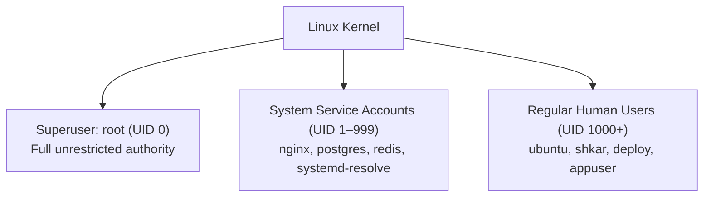
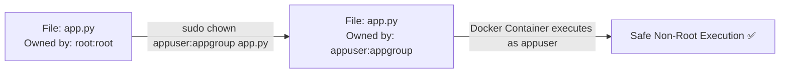

# 🐧 Level 2: Users, Groups & File System Permissions (Intermediate)

Welcome to **Level 2** of the TeachCloud Linux Masterclass. In multi-tenant cloud environments and containerized microservices, understanding Linux security, identity, and access control is essential. This guide teaches you how to manage users, calculate numeric/symbolic permissions, delegate administrative power via `sudo`, and protect sensitive assets like API keys, databases, and SSL certificates.

---

## 🗺️ Level 2 Curriculum Overview

| Module | Core Concepts | Essential Commands & Tokens | Production DevOps Relevance |
| :--- | :--- | :--- | :--- |
| **Lesson 2.1** | Users, Superusers & Identity | `id`, `whoami`, `groups`, `/etc/passwd`, `/etc/shadow`, `/etc/group` | Least-privilege design, container non-root execution (`appuser`), service isolation. |
| **Lesson 2.2** | Standard File Permissions (`rwx`) | `chmod`, `chmod -R`, Octal (`755`, `644`, `600`), Symbolic (`u+x`, `go-w`) | Securing private keys (`id_ed25519` at 600), secrets (`.env`), static assets (644). |
| **Lesson 2.3** | Ownership & Access Delegation | `chown`, `chgrp`, `groupadd`, `usermod -aG sudo` | Transferring file ownership after deployment, granting developers team access. |
| **Lesson 2.4** | Special Permissions & Sudo Security | SUID (`4000`), SGID (`2000`), Sticky Bit (`1777` on `/tmp`), `visudo`, `/etc/sudoers` | Preventing privilege escalation, securing shared scratch directories, safe sudoers syntax. |

---

## 👤 Lesson 2.1 — Users, Superusers & Identity

Linux is built from the ground up as a secure, multi-user operating system. Every process running on the kernel executes under the identity of a specific user.



### The Three Classes of User Accounts:
1. **The Superuser (`root`, UID 0)**:
   * The administrative account with unrestricted power over the kernel, hardware, files, and running processes.
   * *DevOps Best Practice*: **Never log into servers directly as `root`**. Always log in as an unprivileged user and escalate privileges temporarily using `sudo`.
2. **System Service Accounts (UID 1–999)**:
   * Dedicated pseudo-users created to run background daemons with minimal permissions (e.g., `nginx`, `postgres`, `www-data`).
   * These accounts usually have `/usr/sbin/nologin` or `/bin/false` as their shell so no human can log in with them.
3. **Regular Human Users (UID 1000+)**:
   * Interactive accounts for engineers, sysadmins, and CI/CD automation. By default, regular users can only write to their own home directory (`/home/<user>`) and `/tmp`.

### Inspecting User Identity:
* `whoami`: Prints the username of the current effective user.
* `id`: Prints User ID (UID), Primary Group ID (GID), and all supplementary groups.
  ```bash
  id
  # Output: uid=1000(shkar) gid=1000(shkar) groups=1000(shkar),27(sudo),4(adm),998(docker)
  ```
* `groups`: Lists all groups the current user belongs to.

### System Identity Files:
* **`/etc/passwd`** (Publicly readable user registry):
  Contains account metadata formatted as: `username:x:UID:GID:Comment:HomeDirectory:Shell`
  ```bash
  head -n 5 /etc/passwd
  # root:x:0:0:root:/root:/bin/bash
  # appuser:x:1001:1001:App Runner:/app:/bin/bash
  ```
  *(The `x` indicates that the password hash is protected inside `/etc/shadow`).*
* **`/etc/shadow`** (Restricted password database, readable only by root `0600`):
  Stores cryptographic salted hashes (`$6$...` SHA-512 or `$y$...` yescrypt) and expiration policies.
* **`/etc/group`** (Group registry):
  Lists all system groups and their respective members.

---

## 🔒 Lesson 2.2 — Standard Linux File Permissions (`rwx`)

Every file and directory in Linux has an explicit permission triplet that defines who can access it.

```text
  -  r w x  r - x  r - -
  │  └──┬──┘ └──┬──┘ └──┬──┘
  │     │       │       └── Others / World (all other accounts)
  │     │       └────────── Group (members of the assigned group)
  │     └────────────────── Owner / User (the individual creator)
  └──────────────────────── File Type (- = regular file, d = directory, l = symlink)
```

### The Permission Triplet:
1. **User / Owner (`u`)**: The account that owns the file.
2. **Group (`g`)**: Members of the group assigned to the file.
3. **Others / World (`o`)**: Any other authenticated user on the operating system.

### Bitwise Values & The 4-2-1 Rule:
Each permission has a specific numeric weight:
* **Read (`r`) = 4**: View file contents (`cat`, `less`), or list directory contents (`ls`).
* **Write (`w`) = 2**: Edit/save file contents, or create/delete files inside a directory.
* **Execute (`x`) = 1**: Run a script/binary (`./script.sh`), or enter a directory (`cd`).

```text
r w x = 4 + 2 + 1 = 7  (Full Read, Write, Execute)
r w - = 4 + 2 + 0 = 6  (Read and Write)
r - x = 4 + 0 + 1 = 5  (Read and Execute)
r - - = 4 + 0 + 0 = 4  (Read Only)
- - - = 0 + 0 + 0 = 0  (No Access)
```

### Standard Production Permission Sets:
* **`755` (`rwxr-xr-x`)**: Standard for directories and executable scripts. The owner can do everything; group and others can browse and execute.
* **`644` (`rw-r--r--`)**: Standard for web files, HTML templates, CSS, and general configs. The owner can edit; everyone else can read.
* **`600` (`rw-------`)**: **Strict private credentials**. Only the owner can read/write; zero access for everyone else. Used for `.env`, `id_ed25519` SSH private keys, and SSL private keys.
* **`700` (`rwx------`)**: Private directories (such as `~/.ssh`).

### Modifying Permissions with `chmod`:
* **Octal (Numeric) Mode**:
  ```bash
  chmod 600 .env.production           # Lock down secrets file
  chmod 755 entrypoint.sh             # Make deployment script executable
  chmod 600 ~/.ssh/id_ed25519         # Protect private SSH key
  chmod -R 755 /var/www/teachcloud/   # Recursively apply to directory tree
  ```
* **Symbolic Mode**:
  * Add execute to owner: `chmod u+x deploy.sh`
  * Remove write from group and others: `chmod go-w config.json`
  * Add read to all: `chmod a+r public_key.pub`

---

## 👥 Lesson 2.3 — Ownership & Access Delegation

Permissions only work in context of **who** owns the file. The command `chown` controls user and group ownership.



### 1. `chown` (Change Owner and Group)
* Change user owner only:
  ```bash
  sudo chown appuser /app/instance/teach_cloud.db
  ```
* Change both user and group simultaneously:
  ```bash
  sudo chown -R appuser:appgroup /opt/teach-cloud/
  ```

### 2. `chgrp` (Change Group Only)
```bash
sudo chgrp developers /opt/shared_code/
```

### 3. Managing Groups & User Membership
In production environments, developers and DevOps team members are grouped together to share access without needing root passwords:
* Create a new team group:
  ```bash
  sudo groupadd devops
  ```
* Add a user to a supplementary group (`-aG` = append to groups):
  ```bash
  sudo usermod -aG devops shkar
  sudo usermod -aG docker shkar      # Allow running docker without sudo
  ```
  > [!IMPORTANT]
  > Always use the `-a` (append) flag with `-G`. If you omit `-a`, `usermod` will remove the user from all other supplementary groups (including `sudo`)!

---

## 🛡️ Lesson 2.4 — Special Permissions & Sudo Security

Standard `rwx` permissions cover 95% of use cases, but Linux provides three advanced permission bits and the `sudo` governance system for enterprise security.

### 1. The Sticky Bit (`1777` / `+t`)
When multiple users can write to a shared directory (like `/tmp`), standard permissions would allow User A to delete User B's files. The **Sticky Bit** fixes this.
* **Effect**: Even if a directory is world-writable, **only the file's owner or root can delete or rename the file**.
* Inspection:
  ```bash
  ls -ld /tmp
  # drwxrwxrwt 18 root root 4096 Oct 20 10:00 /tmp
  ```
  *(Notice the trailing `t` instead of `x`)*.
* Setting the Sticky Bit:
  ```bash
  chmod +t /shared_scratch/
  chmod 1777 /shared_scratch/
  ```

### 2. SUID (Set User ID) & SGID (Set Group ID)
* **SUID (`4000` / `u+s`)**: When an executable with SUID is run, it executes with the privileges of the **file owner** rather than the user running it (e.g., `/usr/bin/passwd` needs root privileges to write to `/etc/shadow`).
* **SGID on Directories (`2000` / `g+s`)**: Any new file created inside the directory automatically inherits the **group of the directory**, not the primary group of the user who created it. Essential for shared team collaboration directories.
  ```bash
  chmod g+s /var/www/team_assets/
  ```

### 3. Sudo Governance & `/etc/sudoers` Safe Editing
The `sudo` (SuperUser DO) command allows authorized users to execute specific commands as root.
* **The Rule of `visudo`**: **NEVER** edit `/etc/sudoers` directly with `nano` or `vim`. Always use:
  ```bash
  sudo visudo
  ```
  `visudo` performs strict syntax checking before saving. A single typo in `/etc/sudoers` can permanently lock you out of administrative access on the server!
* Granting safe sudo access:
  ```text
  # Allow user 'deploy' to restart nginx and gunicorn without password:
  deploy ALL=(ALL) NOPASSWD: /usr/bin/systemctl restart nginx, /usr/bin/systemctl restart teachcloud
  ```

---

## 🧪 Knowledge Check & Self-Test

1. **What octal permission should you apply to your private SSH key (`~/.ssh/id_ed25519`) or production `.env` file, and why?**
   * *Answer*: `600` (`rw-------`). This guarantees that only the owner can read or modify the credentials, preventing other users on the system or compromised services from reading private keys.
2. **If a directory has permissions `755` and a file inside has `644`, can a user who is not the owner edit the file? Can they read it?**
   * *Answer*: They cannot edit the file (no write permission `w` for others), but they **can** read it (others have `r = 4`).
3. **What is the fatal mistake when running `usermod -G docker <user>` without `-a`?**
   * *Answer*: Without `-a` (append), `usermod` replaces all existing group memberships. The user will be kicked out of all supplementary groups, including `sudo`! Always use `usermod -aG`.
4. **Why does `/tmp` have permission `1777` with the sticky bit `t`?**
   * *Answer*: It allows all users to create temporary files, but the sticky bit prevents any user from deleting or renaming files owned by another user.
