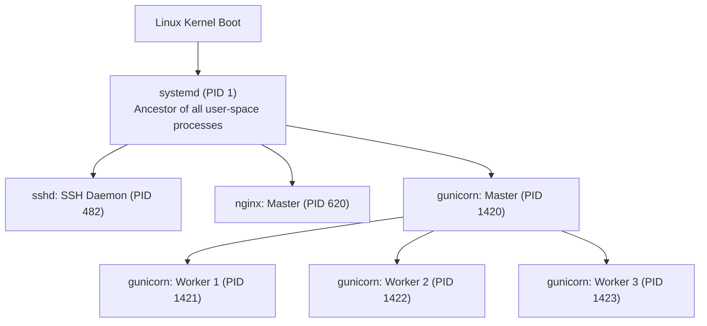
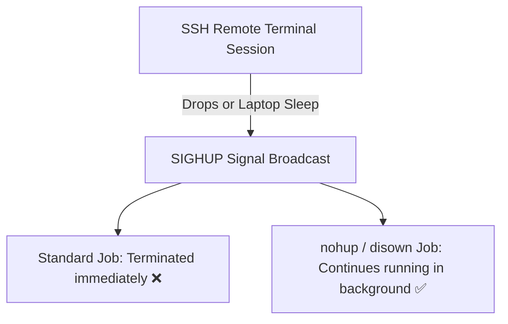

# 🐧 Level 3: Process Lifecycle, Signals & Resource Observability (Intermediate to Advanced)

Welcome to **Level 3** of the TeachCloud Linux Masterclass. In production environments, servers are dynamic systems running dozens of concurrent processes—web servers, database pools, background workers, and monitoring agents. This guide teaches you how to trace process ancestry, manage POSIX signals safely without data corruption, orchestrate background jobs, and monitor host hardware utilization (RAM, CPU load, and disk).

---

## 🗺️ Level 3 Curriculum Overview

| Module | Core Concepts | Essential Commands & Tokens | Production DevOps Relevance |
| :--- | :--- | :--- | :--- |
| **Lesson 3.1** | Process Identification & Tree Structure | `PID`, `PPID`, `systemd (PID 1)`, `ps aux`, `pstree`, `top`, `htop`, `/proc` | Tracking worker parentage (Gunicorn master/workers), finding orphan processes. |
| **Lesson 3.2** | POSIX Signals & Process Termination | `SIGTERM (15)`, `SIGKILL (9)`, `SIGHUP (1)`, `kill`, `pkill -f`, `killall` | Graceful zero-downtime server reloads, safe worker termination, flushing database buffers. |
| **Lesson 3.3** | Foreground, Background & Job Control | `&`, `Ctrl+Z`, `jobs`, `bg`, `fg`, `nohup`, `disown` | Long-running migrations, preventing SSH session disconnection termination. |
| **Lesson 3.4** | Host Performance & Observability | `free -h`, `uptime`, `vmstat 1`, `df -h`, `du -sh *` | Diagnosing Out-Of-Memory (OOM) killer events, CPU saturation, disk starvation. |

---

## 🌲 Lesson 3.1 — Process Identification & Tree Structure

Every executing program in Linux is a **process**. When the Linux kernel boots, it initializes hardware, mounts the root filesystem (`/`), and launches **PID 1** (`systemd` on modern Linux).



### Essential Process Attributes:
* **PID (Process ID)**: A unique integer assigned by the kernel to each running process.
* **PPID (Parent Process ID)**: The PID of the parent process that spawned this process. When Gunicorn or Nginx starts workers, the master process is their PPID.
* **The `/proc` Virtual Filesystem**:
  * `/proc` is not stored on disk—it is a live memory reflection of the Linux kernel.
  * Every PID has its own directory: `/proc/<PID>/`.
  * `/proc/<PID>/cmdline`: The exact command string used to launch the process.
  * `/proc/<PID>/status`: Memory, thread count, and state.
  * `/proc/cpuinfo` & `/proc/meminfo`: Hardware specifications.

### Process Inspection Commands:
1. **`ps aux` (BSD Syntax)**:
   * `a`: Show processes for all users.
   * `u`: Display user/owner-oriented format.
   * `x`: Include processes without a controlling terminal (background daemons).
   ```bash
   ps aux | grep gunicorn
   # ubuntu   1420  0.2  1.8 142050 37400 ?  S    10:00   0:01 gunicorn: master
   # ubuntu   1421  0.5  2.4 158200 48900 ?  S    10:00   0:04 gunicorn: worker [1]
   ```
2. **`pstree -p` (Process Hierarchy)**:
   Visualizes the hierarchical ancestry tree of processes with their PIDs:
   ```bash
   pstree -p
   # systemd(1)─┬─gunicorn(1420)─┬─gunicorn(1421)
   #            │                 ├─gunicorn(1422)
   #            │                 └─gunicorn(1423)
   #            ├─nginx(620)───nginx(621)
   #            └─sshd(482)───sshd(1920)───bash(1925)
   ```
3. **`top` and `htop` (Real-Time Dynamic Monitor)**:
   * Interactive display showing CPU, memory, uptime, and top consumers.
   * Shortcut keys in `top`: `M` (sort by RAM), `P` (sort by CPU), `k` (kill a PID), `q` (quit).

---

## ⚡ Lesson 3.2 — POSIX Process Signals & Termination

Signals are asynchronous notifications sent by the Linux kernel or a user to notify a process that an event has occurred.

```mermaid
flowchart LR
    Caller["Administrator / Kernel"] -->|kill -15 (SIGTERM)| Process["Web Application<br/>(e.g., Gunicorn/Flask)"]
    Process -->|1. Stops accepting new requests<br/>2. Finishes in-flight HTTP requests<br/>3. Closes database connections<br/>4. Exits clean (Code 0)| ExitClean["Clean Termination ✅"]
```

### The Three Critical Production Signals:
1. **`SIGTERM (Signal 15)` — Graceful Termination**:
   * **The default and safest signal**.
   * Tells the application to shut down gracefully: finish current database transactions, flush write buffers to disk, and exit cleanly.
   * Command: `kill -15 <PID>` (or simply `kill <PID>`).
2. **`SIGKILL (Signal 9)` — Unconditional Forced Kill**:
   * **The nuclear option**.
   * Handled directly by the kernel—the process never sees it and **cannot intercept or clean up**.
   * > [!CAUTION]
   * > Never use `kill -9` as your first reaction! It can leave SQLite or PostgreSQL database files in a corrupted state and lock files orphaned on disk. Use `SIGKILL` only if `SIGTERM` does not respond after 15–30 seconds.
   * Command: `kill -9 <PID>`.
3. **`SIGHUP (Signal 1)` — Hangup / Reload Configuration**:
   * Signals daemons (like Nginx, Gunicorn, systemd) to re-read their configuration files and reload workers without dropping active connections.
   * Command: `kill -1 <PID>` or `systemctl reload nginx`.

### Process Termination Commands:
* `kill <PID>`: Send signal to a single PID.
* `pkill -f <pattern>`: Matches pattern against the entire command line (very handy for Python scripts):
  ```bash
  pkill -f "gunicorn.*teachcloud"
  ```
* `killall <name>`: Kills all processes matching exact binary name:
  ```bash
  killall -15 nginx
  ```

---

## 🔄 Lesson 3.3 — Foreground, Background & Job Control

When running database migrations, large file imports, or test suites over remote SSH sessions, job control prevents terminal lockup and accidental termination.



### 1. Launching in the Background (`&`)
Appending an ampersand (`&`) to any command runs it in the background immediately, returning control to your prompt:
```bash
python3 scripts/export_large_data.py &
# Output: [1] 28415  (Job number 1, PID 28415)
```

### 2. Job Control Commands:
* `Ctrl+Z`: Suspends (pauses) the currently running foreground command.
* `jobs -l`: Lists all background jobs in the current shell with their PIDs:
  ```bash
  jobs -l
  # [1]+ 28415 Running    python3 scripts/export_large_data.py &
  ```
* `bg %1`: Resumes suspended job 1 in the background.
* `fg %1`: Brings job 1 back into the foreground.

### 3. Persistent Execution: `nohup` & `disown`
When you close your terminal or lose SSH connection, the shell sends `SIGHUP` to all child processes, terminating them.
* **`nohup` (No Hangup)**: Ignores `SIGHUP` and redirects `stdout` and `stderr` to `nohup.out`:
  ```bash
  nohup python3 backup_db.py > /var/log/backup.log 2>&1 &
  ```
* **`disown -h %1`**: Detaches an already running background job from the shell's process table so closing the terminal won't kill it.

---

## 📊 Lesson 3.4 — Host Performance & Resource Observability

When production incidents occur (502 Bad Gateway, high latency, dropped connections), senior engineers quickly assess the three core bottlenecks: **Memory**, **CPU load**, and **Disk**.

### 1. Memory Observability: `free -h`
```bash
free -h
#               total        used        free      shared  buff/cache   available
# Mem:          3.8Gi       1.2Gi       800Mi        45Mi       1.8Gi       2.4Gi
# Swap:         2.0Gi       120Mi       1.9Gi
```
> [!IMPORTANT]
> **Understanding "Available" vs "Free"**: Linux aggressively uses idle RAM as filesystem read cache (`buff/cache`). This is a performance feature, not a leak! When applications need memory, the kernel instantly frees cache. Always look at the **`available`** column, not `free`!

### 2. System Load & CPU Saturation: `uptime`
```bash
uptime
# 11:00:00 up 12 days,  3:14,  1 user,  load average: 0.15, 0.28, 0.35
```
* The three numbers represent the average number of processes running or waiting for CPU/Disk over the last **1 minute**, **5 minutes**, and **15 minutes**.
* *Rule of thumb*: On a 2-core CPU droplet:
  * Load < 2.0: Server has spare capacity.
  * Load = 2.0: 100% CPU capacity utilized.
  * Load > 2.0: Processes are queueing and slowing down.

### 3. Disk Space & Directory Sizing: `df -h` & `du -sh`
* **Partition usage (`df -h`)**:
  ```bash
  df -h /
  # Filesystem      Size  Used Avail Use% Mounted on
  # /dev/root        59G   14G   45G  24% /
  ```
  *(Alert if `Use%` exceeds 85%)*.
* **Finding large directories (`du -sh *`)**:
  Identifies which folder is consuming disk space:
  ```bash
  du -sh /var/log/* | sort -hr | head -n 5
  # 4.2G    /var/log/journal
  # 1.1G    /var/log/nginx
  # 120M    /var/log/syslog
  ```

---

## 🧪 Knowledge Check & Self-Test

1. **Why should you always try `kill -15` (SIGTERM) before `kill -9` (SIGKILL)?**
   * *Answer*: `SIGTERM` allows the program to safely terminate, flush in-memory buffers to disk, and close open database connections. `SIGKILL` violently stops the process, risking database corruption.
2. **If `free -h` shows only 200MB "free" but 2.2GB "available", is your server running out of memory?**
   * *Answer*: No. Linux uses unused memory for `buff/cache` to speed up disk I/O. The 2.2GB is available to applications immediately whenever requested.
3. **What is PID 1 on modern Linux distributions, and why is it special?**
   * *Answer*: `systemd`. It is the root ancestor of all user-space processes; if PID 1 terminates, the operating system kernel panics and halts.
4. **How do you keep a long-running migration script alive after logging out of an SSH session?**
   * *Answer*: Run it with `nohup python3 migrate.py > migrate.log 2>&1 &` or run it inside a terminal multiplexer like `tmux`.
