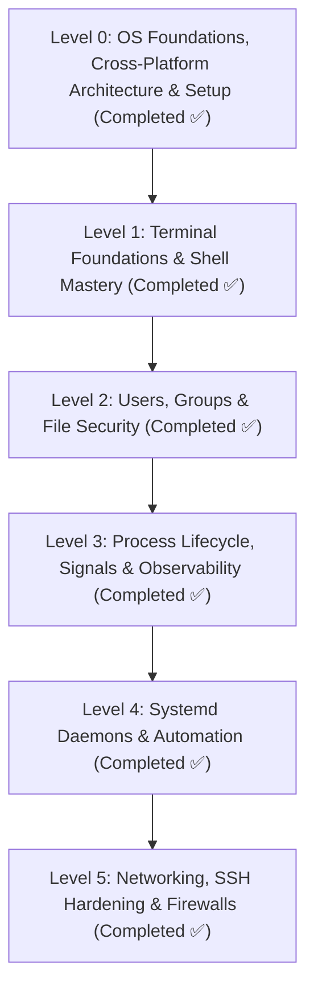

# 🐧 Linux Zero-to-Hero Masterclass Curriculum

Welcome to the comprehensive **Linux from Zero to Hero** engineering roadmap for TeachCloud. This multi-level curriculum takes learners from initial terminal apprehension to advanced production server administration, security hardening, and DevOps observability.

---

## 🗺️ Curriculum Blueprint & Tier Architecture

| Level | Designation | Core Competencies | Primary Commands & Concepts | Real-World Production Context |
| :--- | :--- | :--- | :--- | :--- |
| **Level 0** | **OS Foundations & Cross-Platform Architecture** | Monolithic kernel vs microkernel, unified `/` root vs `C:\` drives, POSIX permissions, package managers, WSL/VM setup | Architecture comparison (Linux vs Windows vs macOS), WSL 2, Hypervisors, Cloud VPS, `uname -a`, `apt update` | Selecting appropriate OS targets, spinning up Linux environments on Windows/macOS/Cloud, understanding server headless advantages. |
| **Level 1** | **Terminal Foundations & Shell Mastery** | Filesystem hierarchy, navigation, text manipulation, I/O streams | `ls -la`, `cd`, `mkdir -p`, `cp -r`, `mv`, `rm -rf`, `cat`, `less`, `head`, `tail -f`, `find`, `grep -rn`, `>`, `>>`, `\|` | Navigating server environments, analyzing live log outputs, inspecting code assets. |
| **Level 2** | **Users, Groups & File Permissions** | Multi-user access control, numeric & symbolic permissions, ownership, sudo delegation | `id`, `whoami`, `chmod`, `chown`, `chgrp`, `groupadd`, `usermod`, `visudo`, `SUID`, `SGID`, `Sticky Bit` | Container non-root isolation, securing secrets (`.env` 600), multi-tenant security. |
| **Level 3** | **Process Lifecycle, Signals & Observability** | Foreground/background jobs, POSIX signals, host resource utilization | `ps aux`, `top`, `htop`, `kill`, `pkill`, `&`, `nohup`, `bg`, `fg`, `free -h`, `df -h`, `uptime` | Diagnosing out-of-memory (OOM) kills, recovering stuck processes, load telemetry. |
| **Level 4** | **Systemd Daemons & Automation** | Service lifecycle, background daemon management, automated scheduling | `systemctl`, `.service` units, `journalctl -u -f`, `crontab -e`, log retention | Running production web servers (Flask/Gunicorn), auto-healing daemons, backup cron. |
| **Level 5** | **Networking, SSH Hardening & Firewalls** | Remote access security, firewall packet filtering, socket diagnostics | `ssh-keygen`, `authorized_keys`, `sshd_config`, `ufw`, `ss -tulpn`, `ip a`, `curl -Iv` | Droplet perimeter security, preventing brute-force attacks, port management. |

---

## 📚 Detailed Syllabus Breakdown

### Level 0: Linux Operating System Foundations & Setup ✅
*Documentation: [`docs/Linux/LEVEL_0_OS_FOUNDATIONS_AND_INSTALLATION.md`](LEVEL_0_OS_FOUNDATIONS_AND_INSTALLATION.md)*

* **Lesson 0.1 — What is Linux? (Kernel vs. Distro)**
  * The Linux Monolithic Kernel (Linus Torvalds, 1991).
  * GNU Userland toolchains (`bash`, `coreutils`, `glibc`).
  * Major distribution families: Debian/Ubuntu (`apt`), Red Hat/Fedora/Rocky (`dnf`), Alpine (containers).
* **Lesson 0.2 — Architectural Comparison: Linux vs. Windows vs. macOS**
  * Monolithic kernel vs Windows Hybrid NT vs macOS XNU Mach/BSD.
  * Inverted single tree root (`/`) vs Windows Drive letters (`C:\`, `D:\`).
  * "Everything is a file" philosophy vs Windows Registry/Win32 APIs.
  * Headless server efficiency (150MB-500MB idle RAM vs 3-4GB GUI baseline).
  * POSIX permissions model (`rwxr-xr-x`) vs Windows ACLs/UAC.
  * Centralized package management (`apt`, `dnf`) vs `.exe` installers vs Homebrew.
  * Why Linux powers 96%+ of cloud servers, 100% of top 500 supercomputers, and all Docker containers.
* **Lesson 0.3 — Installation & Environment Setup Across Platforms**
  * **Windows**: Installing WSL 2 (`wsl --install -d Ubuntu-24.04`) with native file mapping (`/mnt/c/`).
  * **macOS**: High-performance local VMs with OrbStack (`orb create ubuntu:24.04`) or Multipass.
  * **VirtualBox / VMware**: Setting up an isolated sandbox with Ubuntu Server 24.04 ISO.
  * **Bare-Metal Dual-Boot**: UEFI bootable USB (Rufus/Etcher), ext4 partitioning, Secure Boot, GRUB.
  * **Cloud VPS**: Provisioning an Ubuntu 24.04 Droplet / EC2 instance with SSH key authentication.
* **Lesson 0.4 — Post-Installation Verification & Maintenance**
  * Package repository refresh: `sudo apt update && sudo apt upgrade -y`.
  * Diagnostic inspection: `uname -a`, `whoami`, `df -h`, `free -h`, `timedatectl`.

---

### Level 1: Terminal Foundations & Shell Mastery ✅
*Documentation: [`docs/Linux/LEVEL_1_TERMINAL_FOUNDATIONS.md`](LEVEL_1_TERMINAL_FOUNDATIONS.md)*
*Interactive Studio: [`cloud_app/templates/main/linux.html`](../../cloud_app/templates/main/linux.html)*

* **Lesson 1.1 — The Linux File Tree Architecture**
  * Root (`/`), `/etc` (configs), `/var/log` (logs), `/home` (users), `/bin` (binaries), `/opt` (vendors), `/tmp` (scratch).
  * Absolute paths (`/var/log/syslog`) vs relative paths (`.`, `..`, `~`).
* **Lesson 1.2 — Core Navigation & File Manipulation**
  * Practical command operations: `pwd`, `ls -la`, `cd`, `mkdir -p`, `cp -r`, `mv`, `rm -rf`, `touch`.
* **Lesson 1.3 — Reading & Searching File Contents**
  * Bounded vs stream inspection: `cat`, `less` (safe paging for 10GB+ dumps), `head -n 20`, `tail -f` (live log stream).
  * Search tools: `find` (filesystem tree discovery) and `grep -rn` (codebase pattern matching).
* **Lesson 1.4 — I/O Streams, Redirection & Pipes**
  * The three POSIX streams: `stdin (0)`, `stdout (1)`, `stderr (2)`.
  * Redirection operators: Overwrite (`>`), append (`>>`), error redirection (`2>`), stream merging (`2>&1`), bit-bucket (`/dev/null`).
  * In-memory inter-process streaming with the Unix pipe (`|`).

---

### Level 2: Users, Groups & File System Permissions ✅
*Documentation: [`docs/Linux/LEVEL_2_PERMISSIONS_AND_SECURITY.md`](LEVEL_2_PERMISSIONS_AND_SECURITY.md)*

* **Lesson 2.1 — Users, Superusers & Identity**
  * Human user accounts vs system daemon accounts (`nginx`, `postgres`, `appuser`).
  * Identity checking: `id`, `whoami`, `groups`.
  * System databases: `/etc/passwd`, `/etc/shadow` (salted hashes), `/etc/group`.
* **Lesson 2.2 — Standard Linux File Permissions (`rwx`)**
  * Permission matrix: User (owner), Group, Others (`u`, `g`, `o`).
  * Bitwise values: Read (`r = 4`), Write (`w = 2`), Execute (`x = 1`).
  * Octal calculation:
    * `755` (`rwxr-xr-x`): Standard directories and executables.
    * `644` (`rw-r--r--`): Standard public/shared readable files.
    * `600` (`rw-------`): Private cryptographic keys and credentials (`.env`, `id_ed25519`).
  * Applying permissions: `chmod`, recursive mode `chmod -R`.
* **Lesson 2.3 — Ownership & Access Delegation**
  * Modifying ownership: `chown user:group target_file`.
  * Group operations: `groupadd`, `usermod -aG sudo <username>`.
* **Lesson 2.4 — Special Permissions & Sudo Security**
  * The Sticky Bit (`chmod +t` / `1777` on `/tmp` preventing user deletion cross-interference).
  * `SUID` (`4000`) and `SGID` (`2000`) security implications.
  * Sudo governance: Editing `/etc/sudoers` safely with `visudo`, preventing privilege escalation.

---

### Level 3: Process Lifecycle, Signals & Resource Observability ✅
*Documentation: [`docs/Linux/LEVEL_3_PROCESSES_AND_OBSERVABILITY.md`](LEVEL_3_PROCESSES_AND_OBSERVABILITY.md)*

* **Lesson 3.1 — Process Identification & Tree Structure**
  * Process IDs (`PID`), Parent IDs (`PPID`), init/systemd as `PID 1`.
  * Inspecting running processes: `ps aux`, `pstree`, `top`, `htop`, `/proc` hierarchy.
* **Lesson 3.2 — POSIX Process Signals & Termination**
  * Signal dispatching: `SIGTERM (15)` (graceful termination), `SIGKILL (9)` (unconditional kernel kill), `SIGHUP (1)` (reload config).
  * Commands: `kill`, `pkill -f`, `killall`.
* **Lesson 3.3 — Foreground, Background & Job Control**
  * Launching background jobs (`&`), suspending jobs (`Ctrl+Z`), `jobs`, `bg`, `fg`.
  * Persistent execution: `nohup command > output.log 2>&1 &`, `disown`.
* **Lesson 3.4 — Host Performance & Resource Observability**
  * Memory inspection: `free -h` (calculating buffers/cache vs actual free memory).
  * CPU & System Load: `uptime` (1, 5, 15 min load averages), `vmstat 1`.
  * Storage consumption: `df -h` (disk partitions), `du -sh *` (directory sizing).

---

### Level 4: Systemd Daemons & Automation ✅
*Documentation: [`docs/Linux/LEVEL_4_SYSTEMD_AND_AUTOMATION.md`](LEVEL_4_SYSTEMD_AND_AUTOMATION.md)*

* **Lesson 4.1 — Systemd Architecture vs Legacy Init**
  * Units, Targets (`multi-user.target`), and service dependency resolution.
* **Lesson 4.2 — Writing Production `.service` Units**
  * Creating `/etc/systemd/system/teachcloud.service`:
    * `[Unit]`: `Description=`, `After=network.target`.
    * `[Service]`: `Type=simple`, `User=appuser`, `WorkingDirectory=`, `ExecStart=`, `Restart=always`, `RestartSec=5`.
    * `[Install]`: `WantedBy=multi-user.target`.
* **Lesson 4.3 — Service Lifecycle Management**
  * Commands: `systemctl start`, `stop`, `restart`, `reload`, `enable`, `disable`, `status`.
* **Lesson 4.4 — Centralized Systemd Journal Observability**
  * Structured logging with `journalctl`:
    * `journalctl -u teachcloud -f` (live follow).
    * `journalctl -u teachcloud --since "2 hours ago"`.
    * `journalctl -p err -b` (boot error auditing).
* **Lesson 4.5 — Scheduled Automation with Cron**
  * Format: `min hour dom month dow command`.
  * Configuring automated backup schedules (`crontab -e`).

---

### Level 5: Networking, SSH Hardening & Firewalls ✅
*Documentation: [`docs/Linux/LEVEL_5_NETWORKING_AND_SECURITY.md`](LEVEL_5_NETWORKING_AND_SECURITY.md)*
*Command Glossary: [`docs/Linux/COMMAND_GLOSSARY_CHEATSHEET.md`](COMMAND_GLOSSARY_CHEATSHEET.md)*
* **Lesson 5.1 — Network Inspection & Socket Auditing**
  * Network interfaces: `ip a`, `ip route`.
  * Listening port inspection: `ss -tulpn` (identifying ports 80, 443, 22, 5000).
  * Socket connectivity tests: `curl -Iv`, `ping`, `traceroute`, `nc -zv`.
* **Lesson 5.2 — Cryptographic SSH Hardening**
  * Generating modern Ed25519 keys: `ssh-keygen -t ed25519 -C "admin@teachcloud.dev"`.
  * Public key authorization: `~/.ssh/authorized_keys` (`chmod 600`).
  * Hardening `/etc/ssh/sshd_config`:
    * `PasswordAuthentication no`
    * `PermitRootLogin no`
    * `PubkeyAuthentication yes`
* **Lesson 5.3 — Host Firewall with UFW**
  * Default deny policy: `ufw default deny incoming`, `ufw default allow outgoing`.
  * Port rules: `ufw allow 22/tcp`, `ufw allow 80/tcp`, `ufw allow 443/tcp`.
  * Activating firewall: `ufw enable`, `ufw status verbose`.
* **Lesson 5.4 — Package Management & Security Updates**
  * System updates: `apt update && apt upgrade -y`.
  * Automated security patching: `unattended-upgrades`.
